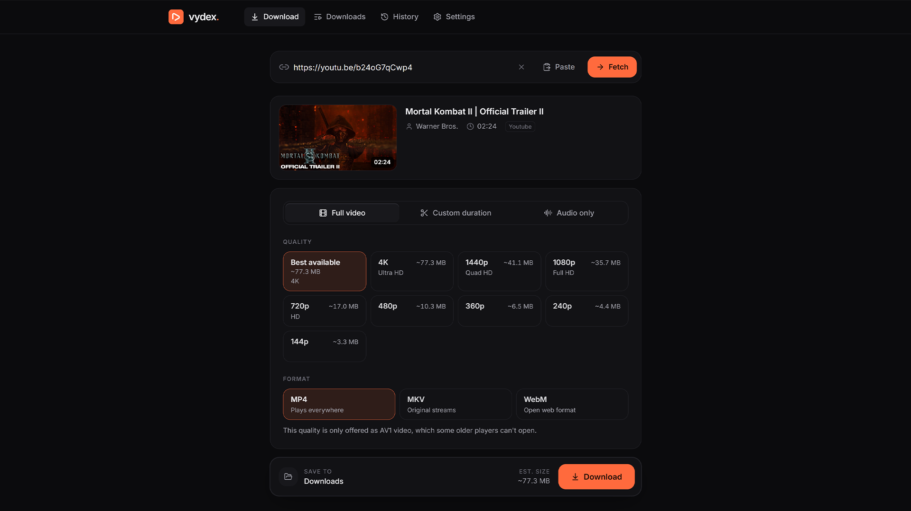
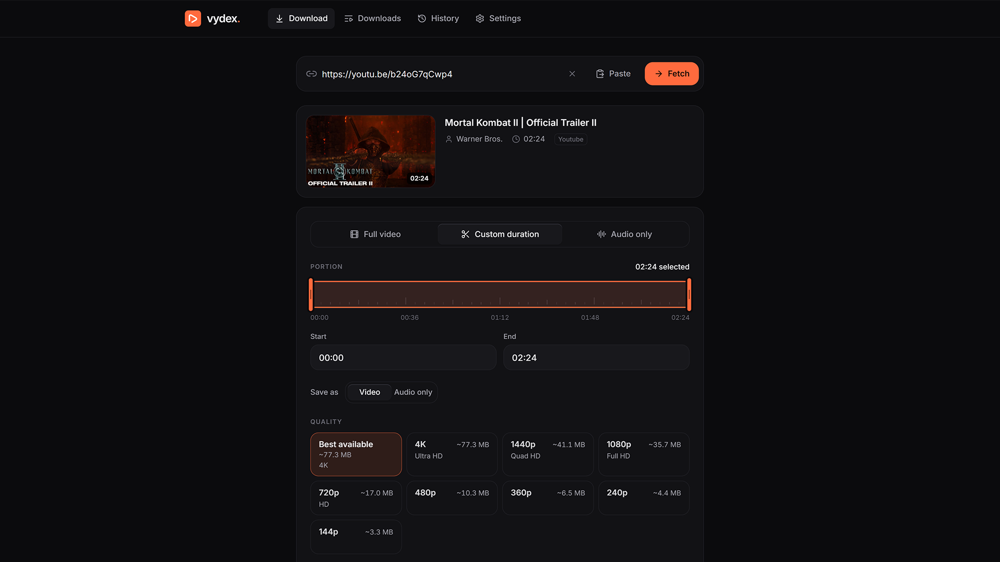

  

<h1 align="center">vydex.</h1>

  Download videos, exact clips, audio and playlists, processed entirely on your own device. 
  <b>Windows</b> and <b>Android</b> · no account · no cloud · no ads

  <a href="https://github.com/Anushmendonca/vydex/releases/latest"><b>⬇ Download the latest version</b></a>

---

## Features

- **Full videos** up to 4K, in MP4, MKV or WebM. Only qualities the video really has are offered.
- **Custom duration:** save just part of a video, cut precisely to the second.
- **Audio only:** MP3, M4A, WAV, or the original audio without conversion.
- **Playlists and channels:** choose which videos you want; they're saved numbered in their own folder.
- Real download progress, a queue, history, and light and dark themes.
- **Android:** Share → Vydex straight from YouTube or your browser. Downloads continue in the background.
- Keeps itself working: the download engine updates automatically when websites change.

## Screenshots

  
  

## Which file do I download?

| You have | Download | |
| --- | --- | --- |
| Windows 10 or 11 | **Vydex-…-windows-x64-portable.exe** | One file. Just double-click it. |
| Windows 10 or 11 | **Vydex-…-windows-x64.zip** | A folder you unzip once. Opens faster. |
| An Android phone (Android 10+) | **Vydex-…-android-arm64.apk** | Install it on your phone. |

**Portable .exe or .zip?** Both are the same Vydex with the same features. The difference is only how it starts:

- **Portable .exe:** nothing to set up. Each time you open it, it first unpacks itself in the background,
  so it takes about **3 seconds** to appear. Great for trying Vydex or keeping it on a USB stick.
- **.zip:** you unzip it once, and after that Vydex opens in about **1 second**.
  Best if you use Vydex regularly.

## Installation

### Windows: portable .exe

1. Download **Vydex-…-windows-x64-portable.exe**.
2. Double-click it. That's it, Vydex opens in your browser.
3. *Optional:* move the file somewhere permanent (for example your Documents folder),
   then right-click it → **Show more options** → **Send to** → **Desktop (create shortcut)**.

### Windows: .zip

1. Download **Vydex-…-windows-x64.zip**.
2. Right-click the zip → **Extract All…** → choose a place (for example `Documents`) → **Extract**.
3. Open the extracted **Vydex** folder and double-click **Vydex.exe**.
4. *Optional, for a desktop icon:* right-click **Vydex.exe** → **Show more options** → **Send to** →
   **Desktop (create shortcut)**. You can also right-click it → **Pin to Start**.

> Keep the **Vydex** folder together: `Vydex.exe` needs the `_internal` folder next to it.
> Move the whole folder if you want it somewhere else, and use a shortcut for your desktop.

### First launch on Windows

If Windows shows *"Windows protected your PC"*, click **More info** → **Run anyway**.
This appears only because the app isn't code-signed yet. You'll only see it the first time.

### Android

1. Download **Vydex-…-android-arm64.apk** on your phone (or copy it to your phone).
2. Tap it, and allow **Install unknown apps** when asked, then tap **Install**.
3. Open Vydex. The first launch takes about 10 seconds to set up.
   Allow notifications so downloads keep running in the background.

## Using Vydex

1. Paste a video link (on Android you can also use **Share → Vydex** in YouTube or your browser).
2. Choose **Full video**, **Custom duration** or **Audio only**, plus the quality and format.
3. Click **Download** and follow the progress.
4. Your files are saved to your **Downloads** folder on Windows (changeable in Settings),
   or **Download/Vydex** on Android.

When you're done, just close the browser tab (Windows) or leave the app (Android). Vydex closes by itself,
after any running downloads finish.

## Privacy

Everything happens on your device. Vydex has no account, no servers, and no tracking.
It only connects to the website you're downloading from, and to GitHub to check for engine updates.

## Troubleshooting

| Problem | Fix |
| --- | --- |
| "This website has changed…" | Open **Settings → Updates → Check now**, install the update, and try again. |
| "Temporarily limiting downloads" | The website is rate-limiting. Wait a few minutes. |
| Private, members-only or age-restricted video | These can't be downloaded. Vydex doesn't sign in to websites. |
| Antivirus warning | Some antivirus tools flag unsigned apps. You can verify your download with the SHA-256 checksums on the release page. |
| Vydex window says it was closed | Vydex closes when you close its tab. Just open Vydex again. |

## Please note

Only download content you have the right to download. Vydex doesn't bypass DRM, paywalls or sign-in requirements.

## Open-source software

Vydex is built on [yt-dlp](https://github.com/yt-dlp/yt-dlp), [FFmpeg](https://ffmpeg.org) (GPL),
Python, Deno and Node.js. Full license notices are included in the app.
FFmpeg source code: https://git.ffmpeg.org/ffmpeg.git
